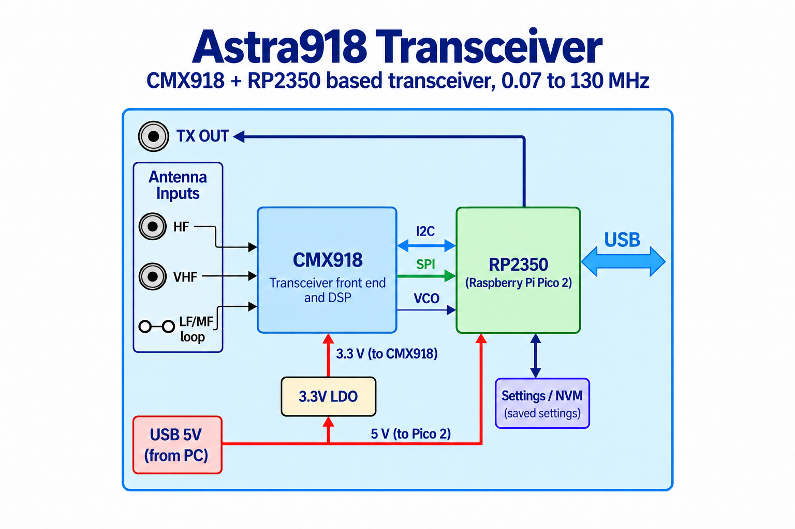

# Astra918 transceiver

CMX918 + RP2350 (Raspberry Pi Pico 2) SDR transceiver firmware with wideband
I/Q reception and audio-driven single-tone FSK transmission for applications
such as WSJT-X. One USB connection exposes 12 kHz mono recording and playback,
a Kenwood-style CAT serial port, and 120 ksps signed 16-bit complex samples.
Use WSJT-X alongside either the SDR++ source or the Rust controller.

The [connection table](docs/TRX.md#connections) describes the CMX918/DRM-1000
and Pico 2 wiring for reception and transmission. It matches the GPIO assignments
in the [EEVblog hardware post](https://www.eevblog.com/forum/rf-microwave/astra918-cmx918rp2350-based-receiver-0-07-to-130-mhz/msg6368579/#msg6368579).



Keep these independent repositories adjacent:

```
astra918sdr/          firmware, shared state/DSP, simulator, CLI
astra918sdr-gui/      Rust light-theme controls/status GUI
```

Receive-mode hardware checks with RP2350A firmware and both Linux applications
cover on-air FT8 reception, simultaneous SDR++/WSJT-X operation, bidirectional
tuning, controls, I/Q stall isolation, Save and incomplete-record recovery.
Native Windows/macOS hardware checks remain pending. No frequency-generator
tests are part of this project's acceptance procedure.

## Tuning

`firmware audio/CAT dial = spectrum center + firmware USB audio offset`, in Hz.
CAT tuning preserves offset and moves the spectrum. Example: dial 14,074,000
and offset +10,000 place the spectrum center at 14,064,000. CAT tuning to
7,074,000 moves that center to 7,064,000.

SDR++ Radio VFOs control local listening independently. Moving a VFO inside the
waterfall leaves firmware audio untouched. Moving the waterfall center retunes
the transceiver and CAT dial while preserving the firmware audio offset. The GUI
exposes this same spectrum-center tuning. Both applications' audio offset controls
move the firmware channel and CAT dial inside the fixed RF spectrum using
command 38. The complete USB/LSB passband must remain within that spectrum.
The legacy command 33/CLI offset operation still preserves dial and moves center.

This center-based application update was compiled on Linux; runtime and hardware
tests were not rerun, as requested. Earlier hardware reports describe the
previous application tuning behavior.

The transceiver is authoritative. Clients read its current state when connecting;
they never restore an old frequency automatically. The entire USB/LSB audio
passband must fit inside ±59.5 kHz. The 120 ksps spectrum has transition-band
roll-off near its edges; this is not a promise of a flat 120 kHz RF passband.
Receive RF tuning limits are 70 kHz–130 MHz, subject to hardware qualification.

Startup without saved settings is 14.2 MHz, USB, zero offset, 100–3500 Hz audio,
AUTO input, RF/IF automatic gain. **Save to transceiver** persists all current
settings, including dial and offset. Ordinary edits never write flash. Saving
briefly pauses reception; two alternating CRC-protected slots retain the older
valid configuration if a write is interrupted.

## Transmitter

Select Astra918's 12 kHz mono playback device in WSJT-X. Firmware tracks the
audio tone and transmits at CAT dial plus the tone in USB or minus it in LSB.
Enable transmit defaults on. The GUI exposes **Audio trigger level**, separate audio
key/unkey delays, a 50 ms TX/RX relay delay and TX output configuration.
Explicit Save persists these choices alongside the receiver and I/Q settings.

Connect CMX918 pin 8 to GP20. RF outputs are GP21 and GP13, with GP13 inverted
in the default Differential mode. GP6 is active-high PTT. Firmware asserts PTT,
waits the relay delay and enables RF. Returning to RX it mutes RF, waits the
same delay and releases PTT. RX/TX transitions retain the USB devices and send
zero recording samples while reception is paused. TX I/Q defaults to zeros.

Enable **Synthesize I/Q during transmit** in the GUI to replace the TX I/Q zeros
with a local monitor of USB playback audio. Its USB/LSB placement follows the
CAT dial and firmware audio offset, so SDR applications can display and demodulate
the transmitted audio. It defaults off, including when migrating older saved
settings. **Save to transceiver** persists the choice.

The [transceiver guide](docs/TRX.md) covers wiring, frequency planning, settings,
the GUI's Test frequency toggle and USB-only maintenance utilities.
I/Q compensation, manual pilot calibration and Factory reset remain available.
The combined integration has offline validation and RP2350A/B build coverage.
Hardware qualification for the combined image is pending.
The GUI's confirmed **Factory reset…** action erases both saved-settings slots
and immediately restores the defaults above. It does not save a new record;
**Save to transceiver** is needed to persist later edits. The GUI keeps I/Q
compensation controls visible but disables them if connected firmware does not
advertise support. Flash matching firmware to enable them. The reset command was
checked in the simulator; the destructive erase was not invoked on a transceiver.

## I/Q compensation

The CMX918's continuous running I/Q compensation is on by default. Optional
internal-pilot calibration is off by default. Enable it in the GUI with
**I/Q compensation on large retune**, or use the CLI:

```sh
target/release/astra918ctl iq-compensation running on
target/release/astra918ctl iq-compensation large-retune on
# Force one calibration using the CMX918 internal pilot tone at the current tune:
target/release/astra918ctl calibrate-iq-now
target/release/astra918ctl save
```

The two controls are independent. When enabled, pilot calibration runs on the
first tune and after a change of receiver path or at least 500 kHz of accumulated
spectrum-center movement since the last successful calibration. The firmware
briefly retunes to one of the discrete pilot frequencies in CMX918 datasheet
Table 11, injects that tone, then powers it down and restores the requested
frequency. The temporary retune can be several MHz; the pilot does not tune
continuously with the dial. If pilot lock or calibration fails, the valid RF tune
still applies; the GUI reports the failure and running compensation continues
if enabled. Repeated automatic attempts are deferred until another 500 kHz
movement or path change; Retry forces an immediate attempt. No external signal generator is
needed. **Calibrate I/Q now (internal pilot tone)** in the GUI, or the CLI
command above, makes one attempt even if automatic large-retune calibration is
off. It briefly pauses I/Q capture and restores the current RF tune afterward.
The result appears in the status; the offline simulator reports calibration
unavailable because it has no CMX918 pilot. This one-shot action is not saved.
With automatic large-retune calibration off, a later RF reconfiguration clears
the one-shot correction; run it again at the new tune if needed.
The checkbox controls apply immediately; only **Save to transceiver** writes them
to flash. Calibration results themselves are not saved. On the connected RP2350A
test board at 3.5 and 14.074 MHz, the manual command reported status 1 (complete),
applied the CMX918's measured correction coefficients, turned off the pilot,
and restored the requested RF tune. This worked with continuous compensation
both off and on. Image-rejection performance has not been measured with an
external signal source.

## Build and run without hardware

Install Rust/rustup, a C toolchain, Python 3 and CMake/Ninja. Rust 1.90.0 and
dependency versions are locked. The host library builds its vendored libusb.

```sh
cargo test --locked --workspace
cargo build --locked --release -p astra918-host
target/release/astra918-sim --cat-pty
# In another terminal:
target/release/astra918ctl --simulator 127.0.0.1:7350 status
cargo run --locked --manifest-path ../astra918sdr-gui/Cargo.toml -- --simulator 127.0.0.1:7350
```

On Windows omit `--cat-pty` and use `.exe` executables. The simulator listens
only on loopback: 7350 control, 7351 framed I/Q, 7352 CAT TCP, 7353 raw PCM16LE.
`--port N` moves all four ports together. It permits one vendor controller at a
time, just like the physical interface. Disconnect the GUI before connecting
SDR++; CAT and audio remain independent. `--settings DIR` isolates saved state.

```sh
# After building the C++ source/module as described in its README:
python3 scripts/test_offline.py
# Optional digital-mode tests, using an external WSJT-X v2.7.0 checkout:
python3 scripts/test_weak_signals.py --source /path/to/WSJTX
# Linux/PipeWire desktop, installed WSJT-X, isolated profile and virtual audio:
python3 scripts/live_wsjtx.py --mode FT8
# Or stop automatically after a decode and external-frequency readback:
python3 scripts/live_wsjtx.py --mode FT8 --verify
```

The weak-signal script needs gfortran, a C++ compiler, Boost headers, NumPy,
SciPy and installed WSJT-X `jt9`/`wsprd`. It builds upstream encoders only inside
ignored `artifacts/`; their licenses remain upstream. It tests USB and LSB
at ±45 kHz offsets through the production DSP. The live helper also supports
FT4 and WSPR. Close its isolated WSJT-X window to remove its temporary audio
nodes and child processes. It does not change normal WSJT-X configuration or
the default audio device. Its waterfall covers the generated 1500 Hz signal.

## CMX918 register access

Stop I/Q with the application's Play/Stop control, or `astra918ctl stop`,
before reading or writing a register. The vendor interface permits one owner:
close any SDR application holding the transceiver before using these commands.
CAT and USB audio remain available while I/Q is stopped. With one connected
transceiver, the CLI and Python helpers select it automatically; use `--serial`
if several are connected.

```sh
python3 scripts/register-read.py 0x07
python3 scripts/register-write.py 0x07 0b00110010
python3 scripts/register-read.py 0x07
# Equivalent CLI commands after building astra918-host:
target/release/astra918ctl register-read 0x07
target/release/astra918ctl register-write 0x07 0x32
```

The read helper displays a byte in hexadecimal and eight-bit binary. Both
helpers accept decimal, `0x` hexadecimal, and `0b` binary addresses/values.
They run `astra918ctl` from the current source via Cargo; `--cli PATH` selects
an already built binary. Use `--simulator 127.0.0.1:7350` for offline practice.
For CMX918 register `$07`, bit 1 enables the 19.2 MHz output on pin 8; bit 0
selects crystal (`0`) or external TCXO (`1`). A raw write replaces the whole
register byte, does not update saved settings, and may be overwritten by a
later receiver reconfiguration. CMX918 pin 9 is unused in the documented wiring.

## Firmware images

Install `picotool` with its UF2 conversion command, then:

```sh
python3 scripts/build_firmware.py
# Explicit board selection gives the same result:
python3 scripts/build_firmware.py --board rpipico2
```

The build produces `artifacts/astra918-rpipico2.uf2`. The ELF and a manifest
recording hashes, source revision and tree state are in `artifacts/rpipico2/`.
The Pico 2 configuration uses a 12 MHz MCU crystal and 4 MiB flash, reserving
the final 8 KiB for settings. CMX918 RESETN is wired to GP2 and firmware drives
it actively low during reset and high afterward.
The CAT USB serial interface also enters RP2350 BOOTSEL when the host sets its
line coding to 1200 baud. On Linux, for example, run
`stty -F /dev/ttyACM0 1200`, wait for the RP2350 boot device to appear, then
`picotool load -v artifacts/astra918-rpipico2.uf2`.
This does not write settings or implement picotool's `-f` reset interface.
Close programs using the CAT port before changing its baud rate; CAT software
configured for 1200 baud would trigger BOOTSEL as well.

Download tagged firmware from [GitHub Releases](https://github.com/ur8us/astra918sdr/releases):
`astra918-rpipico2.uf2` for Raspberry Pi Pico 2. The board profile selects
RP2350A. Additional profiles belong in the build script's `BOARDS` table and
must match their linker, clock and pin configuration.
Pushing a `v*` tag builds and publishes this file. Other builds remain
available as a ZIP artifact of the **Firmware UF2** workflow in GitHub Actions.

## WSJT-X with the transceiver

Select **Kenwood TS-480** or **Kenwood TS-570D**, its CDC serial port, 115200 baud, no handshake,
PTT VOX, Split None, Poll 1 s, and Mode None (preserves the firmware mode chosen
in the controller). Select Astra918 as recording input and playback output.
Use the GUI's Enable transmit control to permit audio-triggered TX, then
select a band in WSJT-X normally. See the [transceiver guide](docs/TRX.md).

Use the OS audio mixer/device so WSJT-X’s 48 kHz capture request is resampled
from the transceiver’s 12 kHz UAC1 stream. On Linux use the PipeWire/PulseAudio
source, rather than an ALSA `hw:` device that cannot resample. This physical
path has been verified on Linux; native Windows/macOS checks remain pending.
CAT setters acknowledge successful
application; queries report applied settings, and external changes appear on
the next poll. `FW;` reports the current audio passband width for Hamlib.

Linux USB access uses [the supplied udev rule](packaging/70-astra918.rules).
Windows descriptors request WinUSB only for vendor interface 4; audio and CDC
retain their class drivers. If binding is needed, select **interface 4 only**.
macOS uses its audio/CDC drivers and libusb for vendor access. Do not reset the
whole USB configuration to connect a controller.

See the [USB protocol](docs/PROTOCOL.md) and
[transceiver guide](docs/TRX.md) for implementation details.
Each host repository has its own build README.
